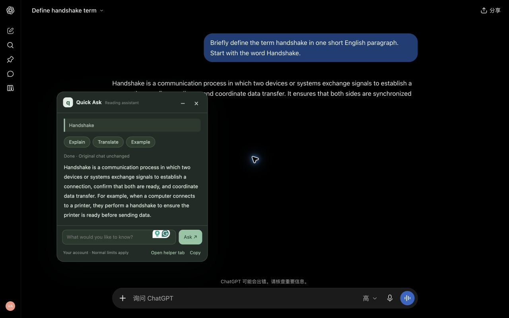

# Quick Ask for ChatGPT

Ask a small question while reading a long ChatGPT response. Select a term or passage to explain, translate, or ask about it in a compact floating panel, without adding a message to the original conversation.

**Experimental prototype · v0.1.2.** Local logic tests and simulated browser interactions have passed. A basic English explanation flow, minimize, and restore were verified in a signed-in Chrome session on November 8, 2026. Other live flows and languages remain to be verified. This is an independent project, not affiliated with or endorsed by OpenAI.

[中文说明](README.zh-CN.md) · [Privacy policy](PRIVACY.md) · [Verification scope](VERIFICATION.md)

## Features

- Select text within one assistant response to open **Explain this** or **Ask…**.
- Explain a passage, translate it, request an example, or enter a custom question.
- Read incremental answers in a movable panel; minimize it, copy the answer, or close it.
- English interface; answers are requested in the surrounding response's language, with explicit language requests taking priority.
- Uses your signed-in ChatGPT website account. No API key or separate model API integration.
- Each question starts a fresh helper chat, keeping messages out of your original conversation.

## Install locally

1. Download this repository as a ZIP and extract it, or clone it.
2. Open `chrome://extensions` in Chrome and enable **Developer mode**.
3. Choose **Load unpacked** and select the extracted folder containing `manifest.json`.
4. Sign in at [chatgpt.com](https://chatgpt.com) in the same Chrome profile.
5. Refresh any existing ChatGPT page, select text in an assistant response, and choose **Explain this** or **Ask…**.

No build, package installation, or local server is required to use the extension.

Use **Enter** to ask and **Shift + Enter** for a new line. **−** minimizes the panel; **Esc** or **×** closes the panel and its helper tab. Do not use the helper tab for unrelated work: the extension may close it when replacing a question or closing the source page.

## How it works

The extension opens a non-active `https://chatgpt.com/` tab, fills its visible message editor, clicks Send once, reads the generated response, and relays it to the panel. It uses normal website controls, without private backend endpoints, extracted session tokens, or direct model APIs.

Each request sends your selection, your question, and up to 1,200 characters from the beginning of the selected assistant response as a language reference. It does not attach the full original conversation or previous panel answers. It uses the website's default model, which may differ from the model or project settings in your original chat.

## Privacy and account usage

- Normal ChatGPT account limits and data settings apply. The extension does not provide unlimited usage or bypass sign-in and verification.
- Questions may appear as separate conversations in ChatGPT history. Closing a tab does not delete them.
- ChatGPT's account-level memory and personalization may still apply. Message separation does not mean complete account-level isolation.
- No developer-operated processing server, analytics service, cookie access, token extraction, or persistent local chat database.
- Temporary prompts and job state use `chrome.storage.session`; panel content is held in page memory. See [PRIVACY.md](PRIVACY.md) for retention details.

Permissions are limited to `https://chatgpt.com/*`, `storage`, and `alarms`. Model-generated content is rendered as plain text, without executing HTML.

## Limitations and troubleshooting

This prototype depends on the current ChatGPT page structure. Website updates, background-tab throttling, editor behavior, verification, and account limits may prevent requests from completing. Choose **Open helper tab** to check the actual page. Handle any sign-in or verification prompt yourself, close the panel, then retry. The extension does not solve CAPTCHAs or automatically resubmit failed questions.

Replies are plain text. Full Markdown, math, and code-block rendering are not provided. A panel follow-up is a new question about the selection, rather than a continued panel conversation. Only `chatgpt.com` in desktop Chrome is matched. No compatibility guarantee is made for other browsers, domains, mobile apps, or ChatGPT desktop app chat surfaces.

The screenshot below shows a real selection-to-answer test on ChatGPT. The sample conversation contains no private chat content.



The earlier local fixture preview is preserved in `preview-local-test.png` and is a simulated page.

## Development and tests

Node.js 22+ recommended. No third-party packages are required.

```sh
npm test
```

Run an interactive local browser fixture without OpenAI requests:

```sh
node tests/browser.cjs --serve
```

Open the printed local URL and choose the test button. The fixture checks selection handling, the panel, request separation, language context, text rendering, editor insertion, response extraction, and existing-chat protection.

`npm run test:browser` runs the headless Chrome harness. Set `CHROME_PATH` if Chrome is installed outside its default macOS path. It uses a new temporary profile, not your signed-in browser profile. Restricted environments may not permit launching it; the interactive fixture is an alternative. See [VERIFICATION.md](VERIFICATION.md) for what has and has not been tested.

The website integration selectors are isolated in `adapter.js`. Other files are `content.js` (panel and selection), `background.js` (jobs and tab ownership), `core.js` (input validation and prompt construction), and `popup.html` / `popup.css` (toolbar help).

## Support and license

For support or privacy questions, contact **zesenl@uci.edu** or open a GitHub issue. Do not post private chat content or credentials in public issues.

[MIT License](LICENSE). Chrome Web Store publication and review are separate from this source-code release.
